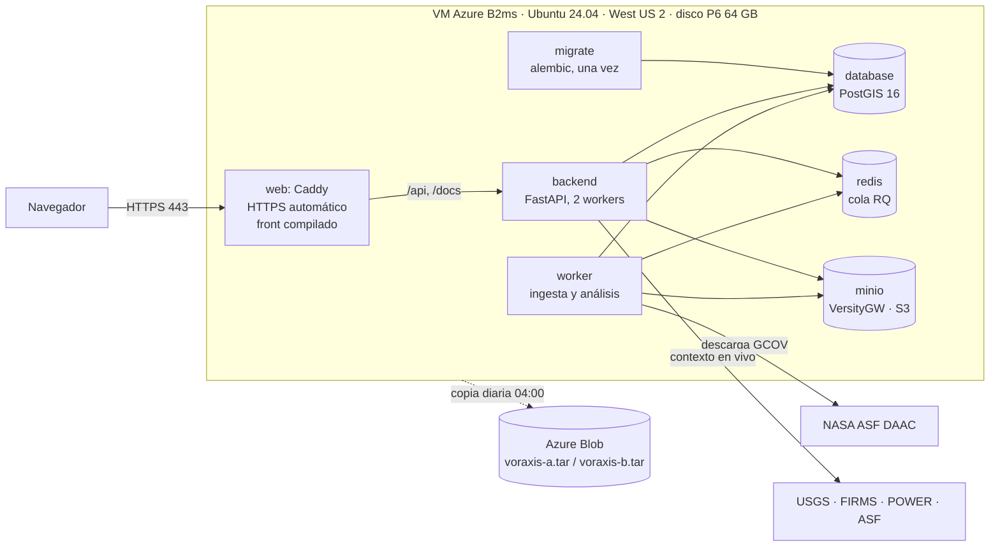

# Despliegue de Voraxis en Azure

Voraxis se publica con la suscripción **Azure for Students** (US$100 de crédito, sin tarjeta) en **una sola VM con Docker Compose**, la misma pila que en desarrollo, con **Caddy** delante para HTTPS. La meta es que funcione bien y sin cortes **al menos un mes**.

> Precios aproximados de noviembre de 2026; confirmarlos en la calculadora de Azure antes de crear recursos.

## 1. Decisiones

| Tema | Decisión | Por qué |
|---|---|---|
| Máquina | **`Standard_B2ms`** (2 vCPU, 8 GB), **encendida todo el mes** | ~US$60 al mes: cabe en el crédito con ~US$40 de margen. Una `B4ms` (16 GB) se acabaría el crédito en unos 25 días |
| Datos | **En el disco de la VM** (VersityGW, igual que en desarrollo) | Hay poco volumen (~1,5 GB) y la API lee los COG de su caché local de todos modos. Es lo más rápido y lo ya probado |
| Copias | **Diarias a Azure Blob Storage** | Si la VM se rompe, se recrea y se restaura. Dos copias alternas (~3 GB) caben en los 5 GB gratis |
| Archivos `.h5` | **Se borran al convertirlos** (`KEEP_DOWNLOADED_GRANULES=false`) | Son 2–7 GB cada uno; tres o cuatro llenarían el disco |
| Zonas de la demo | **Se procesan en tu PC y se suben hechas** | El servidor arranca con todo listo y no descarga decenas de GB |

¿Y un S3 gestionado? VersityGW puede guardar en Azure Blob con su modo `azure` sin tocar el backend, y AWS S3 funcionaría tal cual. No vale la pena para el hackathon: no gana velocidad (la API ya usa una caché local), agrega piezas que no están probadas, y cuando se acaba el crédito Azure desactiva toda la suscripción, Blob incluido. Queda como mejora para después.

## 2. Arquitectura



Solo Caddy publica puertos (80 y 443). PostGIS, Redis, el S3 y la API quedan dentro de la red de Docker.

## 3. Archivos del repositorio

| Archivo | Qué hace |
|---|---|
| `docker-compose.prod.yml` | La pila de producción: sin montar el código, sin `--reload`, reinicio automático, límites de memoria, migraciones antes de arrancar la API |
| `frontend/Dockerfile.prod` | Compila el frontend y lo entrega a una imagen de Caddy |
| `deploy/Caddyfile` | HTTPS, `/api` y `/docs` hacia FastAPI, el resto al frontend, con vuelta a `index.html` para las rutas de React |
| `deploy/env.prod.example` | Plantilla del `.env` del servidor, sin secretos |
| `deploy/backup.sh` | Copia de la base y de todos los objetos en un `.tar`, que sube a Blob |
| `deploy/restore.sh` | Restaura una copia, local o desde Blob |

Memoria asignada en la `B2ms` (8 GB más 4 GB de swap): worker 4 GB, backend 2 GB, base 1 GB, S3 768 MB, Redis 256 MB y Caddy 256 MB.

## 4. Recursos de Azure

| Recurso | Configuración | Costo |
|---|---|---|
| Grupo de recursos | `voraxis-rg`, región **West US 2** (junto a donde ASF guarda NISAR). Si la suscripción no la permite, la región permitida más cercana | — |
| Máquina virtual | `Standard_B2ms`, **Ubuntu Server 24.04 LTS x64**, acceso por **clave SSH** | ~US$60 al mes, del crédito |
| Disco del sistema | **Premium SSD P6, 64 GB** (elegirlo así: otro tipo o tamaño se cobra) | Gratis |
| IP pública | Estándar, **estática**, con etiqueta DNS (por ejemplo `voraxis` → `voraxis.westus2.cloudapp.azure.com`) | Gratis |
| Grupo de seguridad de red | Entrada: **22** solo desde tu IP; **80** y **443** desde Internet | Gratis |
| Cuenta de almacenamiento | Blob, **Hot, LRS**, contenedor privado `voraxis-backups` | Gratis hasta 5 GB |
| Alerta de presupuesto | Cost Management → Presupuestos: US$80, aviso por correo | Gratis |
| Dominio (opcional) | El gratuito de **GoDaddy** (oferta de Space Apps), registro A hacia la IP | Gratis |

**Sin apagado automático:** la VM queda encendida todo el mes. Si en algún momento se apaga, que sea con **"Detener"** en el portal (la desasigna); apagarla desde Linux no detiene el cobro.

## 5. Despliegue paso a paso

### 5.1 Crear los recursos (portal de Azure)

1. **La VM:** crearla con los valores de la sección 4. Puertos de entrada: SSH, HTTP y HTTPS.
2. **La red:** en la IP pública, asignación **estática** y **etiqueta DNS**. En el grupo de seguridad, limitar el 22 a tu IP.
3. **El almacenamiento de copias:** una cuenta de almacenamiento y un contenedor privado `voraxis-backups`. En el contenedor: **Tokens de acceso compartido** → permisos *Leer, Agregar, Crear, Escribir, Enumerar* → vencimiento en 3 meses → **Generar URL de SAS**. Esa URL va en `BACKUP_SAS_URL`.
4. **El presupuesto:** en Cost Management, uno de US$80 con aviso por correo.

### 5.2 Preparar el servidor

```bash
ssh azureuser@voraxis.westus2.cloudapp.azure.com
```

```bash
sudo fallocate -l 4G /swapfile && sudo chmod 600 /swapfile && sudo mkswap /swapfile && sudo swapon /swapfile && echo '/swapfile none swap sw 0 0' | sudo tee -a /etc/fstab
```

```bash
curl -fsSL https://get.docker.com | sudo sh && sudo usermod -aG docker $USER && exit
```

Volver a entrar por SSH (para que valga el grupo `docker`) y clonar:

```bash
git clone https://github.com/JoaquinFigueroa5/VORAXIS.git && cd VORAXIS && cp deploy/env.prod.example .env && nano .env
```

En el `.env`:
- `PUBLIC_URL` y `SITE_ADDRESS`: el dominio.
- `DB_PASSWORD` y la misma contraseña dentro de `DATABASE_URL`.
- `MINIO_PASSWORD`, nueva y larga.
- `EARTHDATA_USERNAME`, `EARTHDATA_PASSWORD` y `FIRMS_API_KEY`, copiados a mano desde tu `.env` local.
- `BACKUP_SAS_URL`, la URL de SAS del paso 5.1.

### 5.3 Llevar los datos ya procesados (desde tu PC)

En tu PC, con la pila de desarrollo encendida:

```bash
bash deploy/backup.sh --compose docker-compose.yml --no-upload --out backups
```

```bash
scp backups/voraxis-backup.tar azureuser@voraxis.westus2.cloudapp.azure.com:~/VORAXIS/backups/
```

### 5.4 Arrancar y restaurar (en la VM)

```bash
docker compose -f docker-compose.prod.yml up -d --build
```

```bash
bash deploy/restore.sh --file backups/voraxis-backup.tar
```

El primer `up` crea los volúmenes y aplica las migraciones; `restore.sh` reemplaza la base y los objetos con los de tu PC y vuelve a levantar todo.

### 5.5 Copias diarias

```bash
(crontab -l 2>/dev/null; echo "0 4 * * * $HOME/VORAXIS/deploy/backup.sh >> $HOME/backup.log 2>&1") | crontab -
```

Probarla una vez a mano con `bash deploy/backup.sh` y comprobar en el portal que aparece `voraxis-a.tar` o `voraxis-b.tar` en el contenedor.

### 5.6 Dominio y comprobación

1. Con el dominio de GoDaddy: registro **A** de `@` hacia la IP pública, y poner ese dominio en `PUBLIC_URL` y `SITE_ADDRESS`. Si no, sirve la etiqueta DNS de Azure.
2. Comprobar que todo responde:
   - `https://<dominio>/api/v1/health` responde `{"status":"ok"…}`.
   - El inicio carga el comparador y los análisis guardados.
   - Un análisis muestra sus capas Antes, Después y Cambio.
   - Explorar y el menú Descargas funcionan.
   - `docker compose -f docker-compose.prod.yml exec backend python scripts/check_api.py` termina sin fallos.

## 6. Operación

| Tarea | Cómo |
|---|---|
| Ver el crédito | Portal → buscar **"Education"** → saldo y días restantes |
| Actualizar el código | `git pull && docker compose -f docker-compose.prod.yml up -d --build` |
| Logs | `docker compose -f docker-compose.prod.yml logs -f backend worker` |
| Estado | `docker compose -f docker-compose.prod.yml ps` |
| Ingesta pesada que no entra en 8 GB | Portal → VM → Tamaño → `B4ms` unas horas (~US$0,17/h) → volver a `B2ms` |
| Restaurar tras un desastre | Nueva VM con 5.2 y luego `bash deploy/restore.sh --slot a` (o `b`, la más reciente) |
| Espacio en disco | `df -h` y `docker system df`; `docker image prune` tras actualizar |

## 7. Riesgos

| Riesgo | Mitigación |
|---|---|
| Se acaba el crédito antes de tiempo | Alerta de US$80; la `B2ms` encendida todo el mes cuesta ~US$60 |
| 8 GB no alcanzan para convertir un HDF5 | Swap de 4 GB; procesar en tu PC y subir con `backup.sh` / `restore.sh`; o `B4ms` unas horas |
| Las conversiones largas van lentas | Las máquinas B gastan su reserva de CPU y bajan de ritmo. No cobra extra; para navegar análisis no se nota |
| Se llena el disco | Los `.h5` se borran solos al convertirlos; vigilar `df -h` |
| Se pierde la VM | Copia diaria en Blob; `restore.sh --slot` |
| La región no está permitida para la suscripción | Usar la región permitida más cercana al oeste de EE. UU. |
| Se filtran credenciales | `.env` solo en la VM; SSH por clave y limitado a tu IP; la URL de SAS solo con permisos sobre el contenedor de copias |
| Vence la URL de SAS | Fijarle un vencimiento posterior a la evaluación, o generar una nueva y cambiarla en `.env` |
